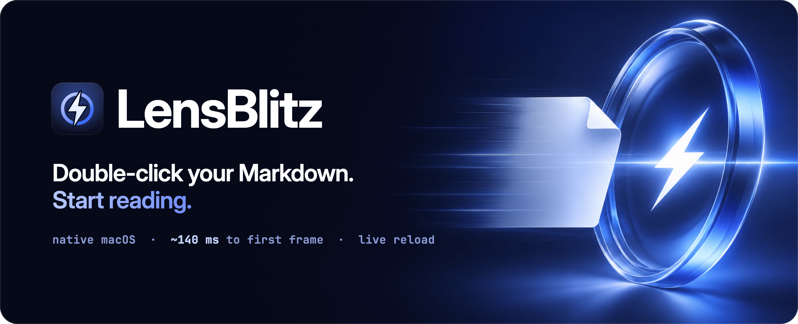
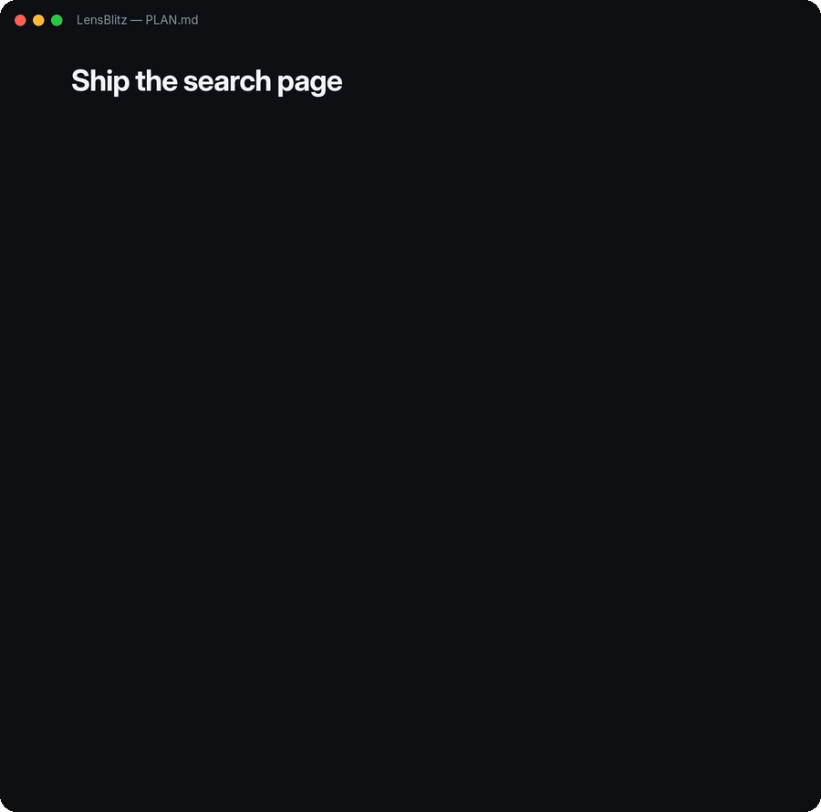
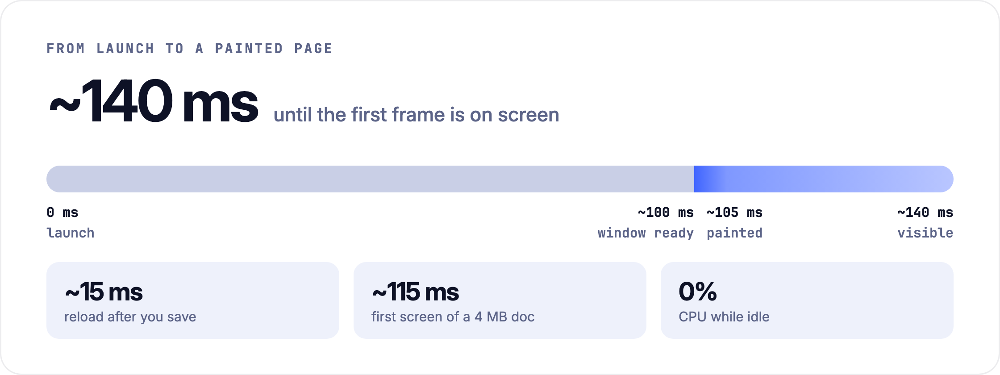

<p align="center">
  
</p>

<p align="center">
  <b>A native Markdown reader for macOS.</b><br>
  On screen in about 140 ms on an M4 Max, beautifully typeset, and live as you save.
</p>

<p align="center">
  
  
  
  
  
</p>

```sh
brew install jamneck/tap/lensblitz
cp -R "$(brew --prefix lensblitz)/LensBlitz.app" /Applications/
```

<br>

## A quick read shouldn't start with a wait

You double-click a `.md` file to read it. Too often a whole editor starts up instead, and you
wait for a tool you didn't need.

Nobody should have to launch a code editor to read a page of text.

## Open it, read it, get back to work

- **On screen in about 140 ms.** Most of that is macOS creating the window.
- **Typeset, not dumped.** Inter and JetBrains Mono built in, highlighted code, real tables,
  alerts, light and dark.
- **Live as you save.** Edit in any editor, or let an AI agent write. The page updates in about
  15 ms and keeps your place.
- **Just for reading.** No editing, no settings, no plugins. It reads Markdown.

<p align="center">
  <picture>
    <source media="(prefers-color-scheme: dark)" srcset="docs/screenshot-dark.png">
    
  </picture>
</p>

## Watch the plan write itself

Keep a `PLAN.md`, a notes file or a README open while you, or your agent, work on it. Every save
shows up in place.

<p align="center">
  
</p>

## Your page, in about 140 ms

<p align="center">
  <picture>
    <source media="(prefers-color-scheme: dark)" srcset="docs/speed-dark.png">
    
  </picture>
</p>

<p align="center"><sub>
  MacBook Pro (M4 Max, macOS 26.2), release build, timed from process start.
  Measure it yourself with <code>LENSBLITZ_TRACE=1 lensblitz file.md</code>.
</sub></p>

No webview, no Electron: a native app, written in Rust. Your file is parsed while the window
opens. What you see is laid out first; the rest follows in the background.

## Reading in three steps

<table>
  <tr>
    <td width="33%" valign="top">
      <h3>1. Install</h3>
      Run the two lines below. Homebrew builds LensBlitz on your Mac and you copy it to Applications.
    </td>
    <td width="33%" valign="top">
      <h3>2. Make it the default</h3>
      Select any <code>.md</code> file in Finder, press <kbd>⌘I</kbd>, choose
      <b>LensBlitz</b> under <b>Open with</b>, then <b>Change All…</b>
    </td>
    <td width="33%" valign="top">
      <h3>3. Double-click</h3>
      Your Markdown files open, ready to read. Edit one anywhere and the page follows.
    </td>
  </tr>
</table>

```sh
brew install jamneck/tap/lensblitz
cp -R "$(brew --prefix lensblitz)/LensBlitz.app" /Applications/
```

<sub>Homebrew installs Rust for the build if you don't have it. Prefer to build it yourself? See
<b>Other ways to install</b> below.</sub>

---

<details>
<summary><b>Everything it renders</b></summary>
<br>

CommonMark and GitHub Flavored Markdown: headings, emphasis, strikethrough, links and bare URLs,
nested and numbered lists, task lists, block quotes, alerts (`> [!NOTE]`), fenced and indented
code with syntax highlighting for about 50 languages, tables with alignment, footnotes,
horizontal rules, YAML front matter, `[[wiki links]]`, and images (PNG, JPEG, GIF, WebP, BMP,
SVG; local or remote).

The HTML commonly found in READMEs works too: ``, `<p align="center">`, `<br>`,
`<kbd>`, `<sub>`/`<sup>`, `<mark>`, `<details>`/`<summary>`, `<a>`, and inline formatting
tags.

Text that Inter and JetBrains Mono don't cover (CJK, Arabic, emoji, …) is drawn with the fonts
installed on your Mac.

Not yet supported:

- Images inside table cells show their alt text; HTML `<table>`s are flattened to lines.
- `<details>` sections are always shown expanded.
- Animated GIFs show their first frame.
- Math (`$…$`) and definition lists are not interpreted.

</details>

<details>
<summary><b>Keys and mouse</b></summary>
<br>

| Keys | |
| :-- | :-- |
| <kbd>⌘O</kbd> / <kbd>⌘W</kbd> / <kbd>⌘R</kbd> | Open, close, reload |
| <kbd>⌘F</kbd>, <kbd>⌘G</kbd> / <kbd>⇧⌘G</kbd> | Find, next / previous match (<kbd>Enter</kbd> / <kbd>⇧Enter</kbd> in the field) |
| <kbd>⌘+</kbd> / <kbd>⌘-</kbd> / <kbd>⌘0</kbd>, pinch | Zoom |
| <kbd>⌘[</kbd> / <kbd>⌘]</kbd> | Back / forward |
| <kbd>⌘T</kbd> | Show or hide the table of contents |
| <kbd>⌘C</kbd>, <kbd>⌘A</kbd> | Copy the selection, select all |
| <kbd>Space</kbd> / <kbd>⇧Space</kbd>, <kbd>↑</kbd> <kbd>↓</kbd>, <kbd>j</kbd> <kbd>k</kbd> | Scroll by page / by line |
| <kbd>⌘↑</kbd> / <kbd>⌘↓</kbd> | Top / bottom |

Drag to select text, double-click for a word, triple-click for a paragraph. Hover a code block
for its copy button. The table of contents appears by itself when the window is wide enough
and the document has at least three headings.

Links to other Markdown files open in the same window (<kbd>⌘[</kbd> goes back); hold
<kbd>⌘</kbd> while clicking to open them in a new window. Web links open in your browser.
Links to other local files are revealed in Finder rather than launched.

</details>

<details>
<summary><b>From the terminal</b></summary>
<br>

```sh
lensblitz README.md              # open a file
lensblitz notes.md todo.md       # one window per file
open -a LensBlitz README.md      # the same, through Finder's machinery
```

You can also drop a file onto a window (it replaces the document; extra files open their own
windows), onto the Dock icon, or press <kbd>⌘O</kbd>.

</details>

<details>
<summary><b>Other ways to install</b></summary>
<br>

**From source.** You need [Rust](https://rustup.rs) 1.95 or newer.

```sh
make install        # builds LensBlitz.app, copies it to /Applications,
                    # and links the `lensblitz` command into /usr/local/bin
```

`make install` builds for the Mac you are on. For a bundle that runs on both Apple Silicon and
Intel, run `make universal` first (needs `rustup target add aarch64-apple-darwin
x86_64-apple-darwin`). Use `make install PREFIX=$HOME/.local APPDIR=$HOME/Applications` to
install without touching system folders. Other targets: `make app`, `make build`,
`make uninstall`.

**Set the default from the terminal** with [`duti`](https://github.com/moretension/duti):

```sh
duti -s com.lensblitz.app net.daringfireball.markdown all
duti -s com.lensblitz.app .md all
```

If LensBlitz isn't in Finder's **Open with** list, open the app once from `/Applications` so
macOS registers it.

The app is signed ad hoc, which is all a Mac needs to run something built on it. It is not
notarised, so it is installed by building from source rather than as a download.

</details>

<details>
<summary><b>Performance in detail</b></summary>
<br>

Measured on a MacBook Pro (M4 Max, macOS 26.2, release build), opening
`examples/showcase.md` from the command line, times from process start:

| | |
| :-- | --: |
| Window and graphics context created | ~100 ms |
| First frame laid out and painted | ~105 ms |
| First frame visible | ~140 ms |
| The same for a 4 MB, 50 000-block document | ~115 ms painted |
| Reload after the file is saved | ~15 ms |
| CPU while idle | 0 % |
| Memory, one full-height Retina window | ~110 MB |

Almost all of the start-up time is macOS creating the application, the window and its OpenGL
context; laying out and painting the first screen takes about 5 ms, and the file is parsed on
another thread in the meantime. About two thirds of the memory is the window's own
Retina-resolution surfaces rather than the document.

</details>

<details>
<summary><b>How it works</b></summary>
<br>

- `src/doc.rs` turns Markdown (`pulldown-cmark`) into a flat list of blocks. Nesting is baked
  into each block as an indent, a marker and "rails", so every block can be laid out on its own.
- `src/layout.rs` lays one block out into galleys and shapes. `src/view.rs` lays out only the
  blocks on screen, measures the rest a few milliseconds per frame, keeps the reading position
  stable while heights settle, and drops the glyph geometry of blocks that scroll far away.
- On reload, content hashes find the unchanged blocks at the start and end of the document, and
  their layout is reused.
- `src/highlight.rs` is a small hand-written lexer for about fifty languages. It has no grammar
  files to load, which keeps start-up and memory flat.
- `src/watch.rs` watches open files with kqueue; `src/images.rs` decodes and fetches images on
  worker threads; `src/macos.rs` receives Finder's "open file" events.

</details>

<details>
<summary><b>Development</b></summary>
<br>

```sh
cargo run -- examples/showcase.md    # debug build
cargo build --profile fast           # optimised, quick to link
make test                            # unit tests
make icon                            # regenerate the icon after editing assets/icon/icon.svg
```

Errors are logged to stderr, prefixed with `lensblitz: error:`. A few environment variables
help with testing:

| Variable | Effect |
| :-- | :-- |
| `LENSBLITZ_TRACE=1` | Print start-up timings and load events |
| `LENSBLITZ_SCREENSHOT=out.png` | Save the first settled frame as a PNG, then quit |
| `LENSBLITZ_SIZE=1280x860` | Window size in points |
| `LENSBLITZ_THEME=dark` / `light` | Force a theme instead of following the system |
| `LENSBLITZ_SCROLL=1200`, `LENSBLITZ_FIND=text` | Start scrolled / with a search open |
| `LENSBLITZ_EXIT_AFTER_FRAMES=3` | Quit after that many frames (for timing runs) |
| `LENSBLITZ_CLOSE_AFTER=2` | Close each window in turn after that many seconds |

</details>

<details>
<summary><b>Fonts</b></summary>
<br>

LensBlitz embeds [Inter](https://rsms.me/inter/) (roman and italic) and
[JetBrains Mono](https://www.jetbrains.com/lp/mono/), both under the SIL Open Font License 1.1
(`assets/fonts/OFL-*.txt`). The files are variable fonts limited to weights 400–700, with
programming ligatures and stylistic alternates removed.

</details>

---

<h3 align="center">Your next README is one double-click away.</h3>

```sh
brew install jamneck/tap/lensblitz
cp -R "$(brew --prefix lensblitz)/LensBlitz.app" /Applications/
```

<p align="center">
  <sub>
    MIT licensed · Built at <a href="https://dimensie.co.za"><b>Dimensie</b></a> and
    <a href="https://jams.digital"><b>Jams Digital</b></a><br>
    Want software that does one job, and does it fast?
    <a href="https://dimensie.co.za">Tell Dimensie what you need →</a>
  </sub>
</p>
