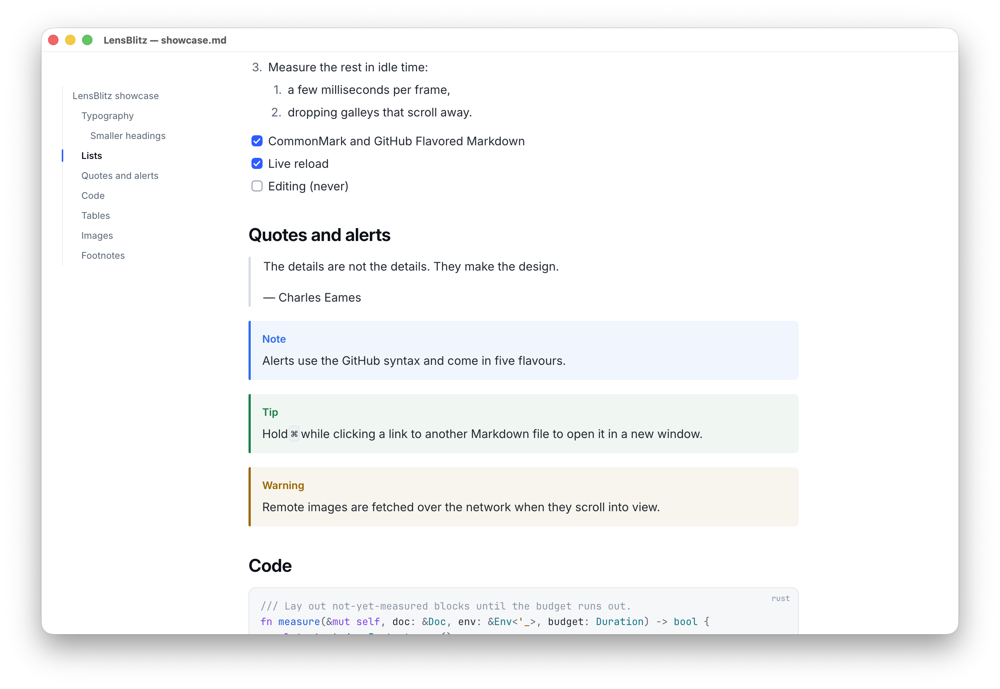
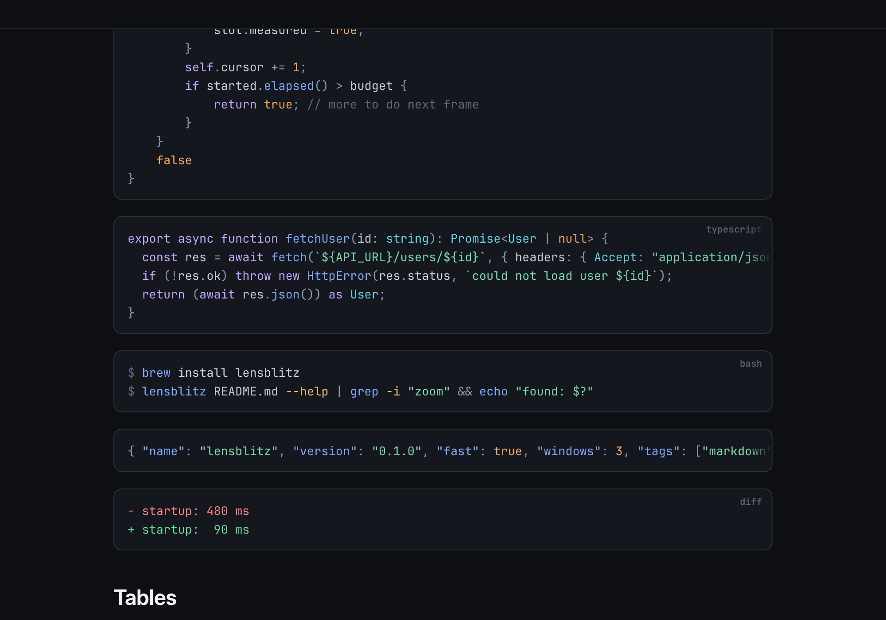

# LensBlitz

An extremely fast, read-only Markdown viewer for macOS. Double-click a `.md` file and it is
on screen, beautifully typeset, before you have let go of the mouse.



- **Fast.** A native binary (Rust, `egui`, no webview). The document is parsed while the
  window is being created, and only what is on screen is laid out.
- **Beautiful.** Inter and JetBrains Mono are built in; headings use optical sizes, code is
  highlighted, images are decoded off the main thread. Follows the system light/dark mode.
- **Single-purpose.** It reads Markdown. No editing, no settings, no plugins.



## Install

### From source

You need [Rust](https://rustup.rs) 1.95 or newer.

```sh
make install        # builds LensBlitz.app, copies it to /Applications,
                    # and links the `lensblitz` command into /usr/local/bin
```

`make install` builds for the Mac you are on. For a bundle that runs on both Apple Silicon
and Intel, run `make universal` first (needs `rustup target add aarch64-apple-darwin
x86_64-apple-darwin`). Use `make install PREFIX=$HOME/.local APPDIR=$HOME/Applications` to
install without touching system folders.

Other targets: `make app` (just build `dist/LensBlitz.app`), `make build` (just the
binary, in `target/release/lensblitz`), `make uninstall`.

### Homebrew

`Formula/lensblitz.rb` builds the same thing with Homebrew, from
`github.com/jamneck/lensblitz`. Put the formula in a tap and install it:

```sh
brew tap-new jamneck/tap
cp Formula/lensblitz.rb "$(brew --repository jamneck/tap)/Formula/"
brew install --HEAD jamneck/tap/lensblitz
```

The repository is private, so git must be able to read it (an SSH key or a credential
helper). Homebrew prints how to copy the bundled `LensBlitz.app` into `/Applications`
afterwards. Note that `brew install` also upgrades any outdated packages the build depends
on, such as `rust`.

## Make LensBlitz the default app for Markdown

1. Select any `.md` file in Finder and press <kbd>⌘I</kbd> (Get Info).
2. Under **Open with**, choose **LensBlitz**.
3. Click **Change All…** and confirm.

From then on a double-click opens the file in LensBlitz. If LensBlitz is not in the list,
open the app once from `/Applications` so macOS registers it.

Prefer the terminal? With [`duti`](https://github.com/moretension/duti) installed:

```sh
duti -s com.lensblitz.app net.daringfireball.markdown all
duti -s com.lensblitz.app .md all
```

## Use

```sh
lensblitz README.md              # open a file
lensblitz notes.md todo.md       # one window per file
open -a LensBlitz README.md      # the same, through Finder's machinery
```

You can also drop a file onto a window (it replaces the document; extra files open their
own windows), onto the Dock icon, or press <kbd>⌘O</kbd>.

The window follows the file: save it in any editor and the view updates in place, keeping
your reading position. Links to other Markdown files open in the same window, with
<kbd>⌘[</kbd> to go back; hold <kbd>⌘</kbd> while clicking to open them in a new window.
Web links open in your browser. Links to other local files are revealed in Finder rather
than launched.

| Keys | |
| :-- | :-- |
| <kbd>⌘O</kbd> / <kbd>⌘W</kbd> / <kbd>⌘R</kbd> | Open, close, reload |
| <kbd>⌘F</kbd>, <kbd>⌘G</kbd> / <kbd>⇧⌘G</kbd> | Find, next / previous match (<kbd>Enter</kbd> / <kbd>⇧Enter</kbd> in the field) |
| <kbd>⌘+</kbd> / <kbd>⌘-</kbd> / <kbd>⌘0</kbd>, pinch | Zoom |
| <kbd>⌘[</kbd> / <kbd>⌘]</kbd> | Back / forward |
| <kbd>⌘T</kbd> | Show or hide the table of contents |
| <kbd>⌘C</kbd>, <kbd>⌘A</kbd> | Copy the selection, select all |
| <kbd>Space</kbd> / <kbd>⇧Space</kbd>, <kbd>↑</kbd> <kbd>↓</kbd>, <kbd>j</kbd> <kbd>k</kbd> | Scroll by page / by line |
| <kbd>⌘↑</kbd> / <kbd>⌘↓</kbd> | Top / bottom |

Drag to select text, double-click for a word, triple-click for a paragraph. Hover a code
block for its copy button. The table of contents appears by itself when the window is wide
enough and the document has at least three headings.

## What it renders

CommonMark and GitHub Flavored Markdown: headings, emphasis, strikethrough, links and bare
URLs, nested and numbered lists, task lists, block quotes, alerts (`> [!NOTE]`), fenced and
indented code with syntax highlighting, tables with alignment, footnotes, horizontal rules,
YAML front matter, `[[wiki links]]`, and images (PNG, JPEG, GIF, WebP, BMP, SVG; local or
remote).

The HTML commonly found in READMEs is understood too: ``, `<p align="center">`,
`<br>`, `<kbd>`, `<sub>`/`<sup>`, `<mark>`, `<details>`/`<summary>`, `<a>`, and inline
formatting tags.

Text that Inter and JetBrains Mono do not cover (CJK, Arabic, emoji, …) is drawn with the
fonts installed on your Mac.

Known gaps in this prototype:

- Images inside table cells show their alt text; HTML `<table>`s are flattened to lines.
- `<details>` sections are always shown expanded.
- Animated GIFs show their first frame.
- Math (`$…$`) and definition lists are not interpreted.

## Performance

Measured on a MacBook Pro (M4 Max, macOS 26.2, release build), opening
`examples/showcase.md` from the command line, times from process start:

| | |
| :-- | --: |
| Window and graphics context created | ~100 ms |
| First frame laid out and painted | ~105 ms |
| First frame visible | ~140 ms |
| The same for a 4 MB, 50 000-block document | ~115 ms painted |
| Reload after the file is saved | ~15 ms |
| CPU while idle | 0 % |
| Memory, one full-height Retina window | ~110 MB |

Almost all of the start-up time is macOS creating the application, the window and its
OpenGL context; laying out and painting the first screen takes about 5 ms, and the file is
parsed on another thread in the meantime. About two thirds of the memory is the window's own
Retina-resolution surfaces rather than the document.

To take your own measurements:

```sh
LENSBLITZ_TRACE=1 lensblitz examples/showcase.md
```

## How it works

- `src/doc.rs` turns Markdown (`pulldown-cmark`) into a flat list of blocks. Nesting is
  baked into each block as an indent, a marker and "rails", so every block can be laid out
  on its own.
- `src/layout.rs` lays one block out into galleys and shapes. `src/view.rs` lays out only
  the blocks on screen, measures the rest a few milliseconds per frame, keeps the reading
  position stable while heights settle, and drops the glyph geometry of blocks that scroll
  far away.
- On reload, blocks are matched by content hash, so only what changed is laid out again.
- `src/highlight.rs` is a small hand-written lexer for about fifty languages. It has no
  grammar files to load, which keeps start-up and memory flat.
- `src/watch.rs` watches open files with kqueue; `src/images.rs` decodes and fetches images
  on worker threads; `src/macos.rs` receives Finder's "open file" events.

## Development

```sh
cargo run -- examples/showcase.md    # debug build
cargo build --profile fast           # optimised, quick to link
make test                            # unit tests
make icon                            # regenerate the icon after editing assets/icon/icon.svg
```

Errors are logged to stderr, prefixed with `lensblitz: error:`. A few environment
variables help with testing:

| Variable | Effect |
| :-- | :-- |
| `LENSBLITZ_TRACE=1` | Print start-up timings and load events |
| `LENSBLITZ_SCREENSHOT=out.png` | Save the first settled frame as a PNG, then quit |
| `LENSBLITZ_SIZE=1280x860` | Window size in points |
| `LENSBLITZ_THEME=dark` / `light` | Force a theme instead of following the system |
| `LENSBLITZ_SCROLL=1200`, `LENSBLITZ_FIND=text` | Start scrolled / with a search open |
| `LENSBLITZ_EXIT_AFTER_FRAMES=3` | Quit after that many frames (for timing runs) |
| `LENSBLITZ_CLOSE_AFTER=2` | Close each window in turn after that many seconds |

The app bundle is signed ad hoc, which is all a Mac needs to run something built on it.
To give the app to other people you will want a Developer ID signature and notarisation.

## Fonts

LensBlitz embeds [Inter](https://rsms.me/inter/) (roman and italic) and
[JetBrains Mono](https://www.jetbrains.com/lp/mono/), both under the SIL Open Font
License 1.1 (`assets/fonts/OFL-*.txt`). The files are variable fonts limited to weights
400–700, with programming ligatures and stylistic alternates removed.
