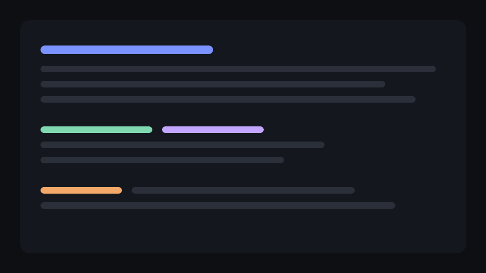

<p align="center">
  
</p>

<h1 align="center">LensBlitz showcase</h1>

<p align="center">
  
</p>

A single document that exercises everything the renderer supports. Open it with
`lensblitz examples/showcase.md`, then edit it in any editor: the window follows along.

## Typography

Body text is set in **Inter** at sixteen points with generous leading, because long-form
reading is the whole job. You get *emphasis*, **strong emphasis**, ***both at once***,
~~strikethrough~~, `inline code`, <kbd>⌘</kbd> + <kbd>F</kbd> key caps, <mark>highlights</mark>,
H<sub>2</sub>O and E = mc<sup>2</sup>, and [links](https://www.rust-lang.org) that open in
your browser. Bare URLs such as https://commonmark.org/help_(guide) are linked too.

Unicode is handled by the system: 日本語, 한국어, العربية, Ελληνικά, кириллица — and emoji 🚀 ✅ 🎯.

### Smaller headings

#### Level four

##### Level five

###### Level six

## Lists

- Speed first: the first frame is on screen before most apps have created a window.
- Beauty second:
  - optical sizes for headings,
  - real italics, not slanted romans,
    - and bullets that change shape as they nest.
- Nothing else. No settings, no editing, no plugins.

1. Parse with `pulldown-cmark`.
2. Lay out only what is visible.
3. Measure the rest in idle time:
   1. a few milliseconds per frame,
   2. dropping galleys that scroll away.

- [x] CommonMark and GitHub Flavored Markdown
- [x] Live reload
- [ ] Editing (never)

## Quotes and alerts

> The details are not the details. They make the design.
>
> — Charles Eames

> [!NOTE]
> Alerts use the GitHub syntax and come in five flavours.

> [!TIP]
> Hold <kbd>⌘</kbd> while clicking a link to another Markdown file to open it in a new window.

> [!WARNING]
> Remote images are fetched over the network when they scroll into view.

## Code

```rust
/// Lay out not-yet-measured blocks until the budget runs out.
fn measure(&mut self, doc: &Doc, env: &Env<'_>, budget: Duration) -> bool {
    let started = Instant::now();
    while self.cursor < self.slots.len() {
        let slot = &mut self.slots[self.cursor];
        if !slot.measured {
            slot.height = layout_block(&doc.blocks[self.cursor], env).height;
            slot.measured = true;
        }
        self.cursor += 1;
        if started.elapsed() > budget {
            return true; // more to do next frame
        }
    }
    false
}
```

```typescript
export async function fetchUser(id: string): Promise<User | null> {
  const res = await fetch(`${API_URL}/users/${id}`, { headers: { Accept: "application/json" } });
  if (!res.ok) throw new HttpError(res.status, `could not load user ${id}`);
  return (await res.json()) as User;
}
```

```bash
$ brew install lensblitz
$ lensblitz README.md --help | grep -i "zoom" && echo "found: $?"
```

```json
{ "name": "lensblitz", "version": "0.1.0", "fast": true, "windows": 3, "tags": ["markdown", "viewer"] }
```

```diff
- startup: 480 ms
+ startup:  90 ms
```

## Tables

| Feature        | Shortcut        |   Scope | Notes                                  |
| :------------- | :-------------: | ------: | :------------------------------------- |
| Find           | <kbd>⌘F</kbd>   |  window | Enter and ⇧Enter step through matches  |
| Zoom           | <kbd>⌘+</kbd>   |  window | Pinch works as well                    |
| Contents       | <kbd>⌘T</kbd>   |  window | Appears by itself in wide windows      |
| Back / forward | <kbd>⌘[</kbd>   | history | After following a link to another file |

## Images



Images are decoded off the main thread, scaled to the screen, and never wider than the column.


---

## Footnotes

Layout is virtualised[^1] and reloads keep unchanged blocks[^2].

[^1]: Only blocks near the viewport hold glyph geometry; the rest keep just a height.
[^2]: Blocks are compared by content hash, so an edit re-lays-out only what changed.

<details>
<summary>A collapsed section (shown expanded)</summary>

HTML `<details>` blocks are rendered open, with their summary as a heading line.

</details>
